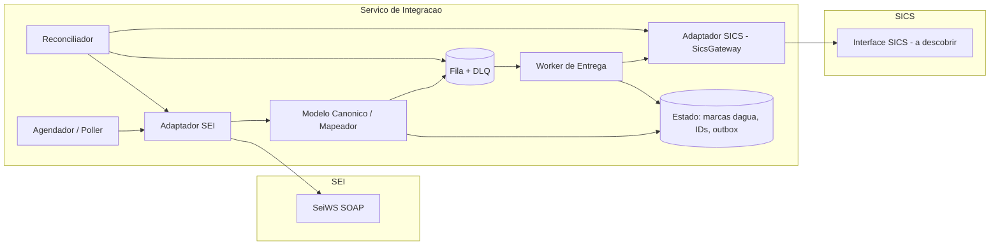
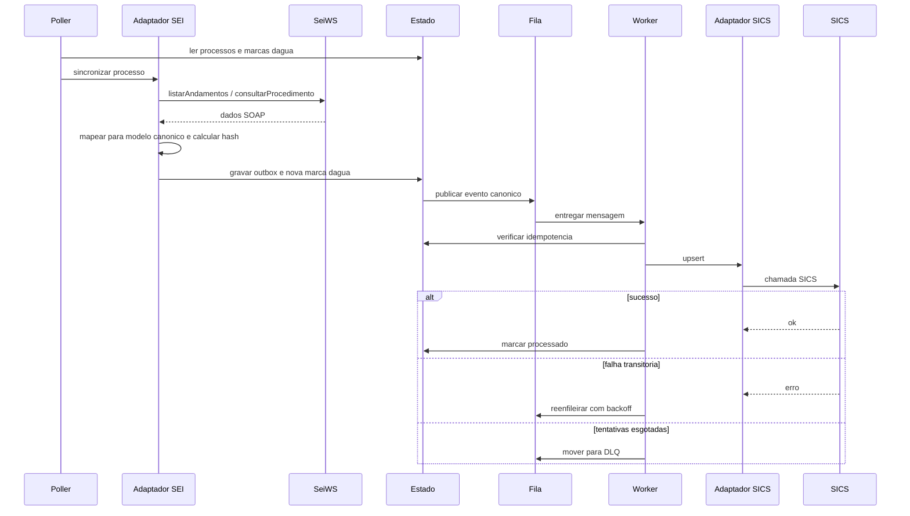

# 02. Arquitetura de integração SEI → SICS

Nada foi verificado contra um ambiente SEI real. O desenho parte do mapa do Especialista em SEI (arquivo 01) e os pontos marcados "a confirmar" precisam de validação com o administrador do SEI.

## 1. Arquitetura alvo

Um serviço de integração intermediário e autônomo, com camada anticorrupção em três partes:

- **Adaptador SEI**: cliente SOAP do SeiWS (`consultarProcedimento`, `listarAndamentos`, `consultarDocumento`). Isola WSDL, autenticação (SiglaSistema + IdentificacaoServico), codificação (ISO-8859-1 no exemplo oficial do manual 4.0; a confirmar na versão instalada) e erros SOAP.
- **Modelo canônico**: `Processo`, `Documento`, `Andamento`, `Unidade`, `Interessado`, com chave natural (protocolo formatado + IdProcedimento) e hash de conteúdo.
- **Adaptador SICS**: porta abstrata `SicsGateway` (`upsertProcesso`, `upsertDocumento`, `registrarEvento`). A implementação fica em aberto até a descoberta do item 7.

Não há acesso direto ao banco do SEI: toda leitura e escrita passa pelos serviços oficiais. O estado próprio do integrador (marcas d'água, mapeamento de IDs, outbox, auditoria) fica em banco dele.

## 2. Estratégia de sincronização

**Polling incremental**, porque o SEI não tem webhooks nativos (confirmado para o manual 4.0; a confirmar em 5.x).

- **Risco principal**: o SeiWS consulta por protocolo e não tem operação do tipo "liste processos alterados desde X" (confirmado pelo Especialista em SEI). É preciso definir como o integrador descobre o conjunto de processos a acompanhar. Opções:
  - lista de interesse mantida pelo SICS ou pelo integrador;
  - listagem por unidade via mod-wssei, se instalado (capacidade a confirmar no Swagger da instalação);
  - processos gerados pela própria integração (`gerarProcedimento`);
  - lista periódica de protocolos gerada e entregue pelo administrador do SEI (relatório ou exportação), sem acesso do integrador ao banco;
  - módulo SEI customizado, apenas como último recurso.

  Decisão D1 do Governador (README): o integrador não lê o banco do SEI nem visões dele, o que mantém a ADR 2. A ordem de preferência é a da lista acima, e a escolha é fechada no marco M0.
- **Marca d'água**: por processo, o último andamento processado (IdAndamento/DataHora) mais o hash do snapshot. Relê-se com janela de sobreposição e deduplica-se; o relógio local não serve de referência.
- **Frequência (estimativa, a calibrar com volume e limites do SEI)**:
  - processos ativos: a cada 5 a 15 min;
  - processos inativos: a cada 1 a 6 h;
  - reconciliação completa: diária, fora do horário de pico;
  - concorrência limitada, para não onerar o SEI.

## 3. Confiabilidade

- **Idempotência**: chave `(idProcedimento, idAndamento | idDocumento, hash)`, com upsert no SICS e tabela de mensagens processadas.
- **Fila**: desacopla a coleta da entrega, com outbox transacional no banco do integrador. Entrega pelo menos uma vez, consumidor idempotente.
- **Retentativas**: backoff exponencial com jitter só para erros transitórios (timeout, 5xx, falha SOAP de infraestrutura). Erros de negócio não são retentados.
- **Dead-letter**: recebe a mensagem após N tentativas, com motivo e reprocessamento manual.
- **Circuit breaker**: um por adaptador (SEI e SICS). Aberto, pausa o poller sem perder a marca d'água.
- **Reconciliação**: job periódico que compara snapshot do SEI com o estado no SICS e reemite as divergências.
- **Observabilidade**: ID de correlação, atraso de sincronização por processo, tamanho da DLQ, taxa de erro por operação.

## 4. Direção do fluxo

- **Fase principal**: SEI → SICS, somente leitura no SEI.
- **Fase opcional**: SICS → SEI via `incluirDocumento`, `enviarProcesso`, `gerarProcedimento` e `lancarAndamento` (todas presentes no manual 4.0).
  - Exige permissões de escrita no serviço cadastrado.
  - Exige idempotência mais rígida, pois o SEI não desfaz inclusões.
  - Exige marcação de origem, para o poller não reimportar o que o próprio integrador gravou.

## 5. Diagramas

## 6. Decisões (ADR resumidas)

| # | Decisão | Alternativas descartadas |
|---|---|---|
| 1 | Serviço intermediário com camada anticorrupção | Ponto a ponto dentro do SICS: acopla o SICS ao SOAP e às versões do SEI |
| 2 | Somente APIs oficiais para leitura e escrita de dados | Leitura direta ou CDC no banco do SEI: sem contrato, quebra em atualização, risco de segurança e governança |
| 3 | Polling incremental | Webhooks: inexistentes. Módulo PHP customizado no SEI emitindo eventos: exige manutenção a cada versão; reavaliar só se a latência exigir |
| 4 | SeiWS como canal primário | mod-wssei: depende de instalação e é voltado ao app móvel; fica como complemento para listagem. PEN/Tramita: serve a trâmite entre órgãos, não a sincronização interna |
| 5 | Entrega pelo menos uma vez, com idempotência | Exatamente uma vez distribuído: complexidade sem ganho |
| 6 | Fila e outbox | Chamada síncrona poller → SICS: propaga indisponibilidade |

**Opções de tecnologia, sem preferência fechada:**

- Fila: RabbitMQ, Kafka, SQS ou tabela-fila em PostgreSQL.
- Runtime: Java/Spring, .NET, Node ou Python (zeep), todos com cliente SOAP maduro.
- Agendamento: cron, Quartz ou Temporal.

A escolha depende da stack e da operação do órgão.

## 7. O que descobrir do SICS

1. Stack, hospedagem e topologia de rede (alcance entre integrador, SEI e SICS).
2. Forma de entrada: API REST/SOAP, fila, arquivo ou banco; se há ambiente de homologação.
3. Autenticação e autorização.
4. Modelo de dados: entidades equivalentes a processo, documento e andamento; campos obrigatórios; chaves.
5. Suporte a upsert ou chave externa, para idempotência.
6. Tratamento de documentos: binário ou só metadados, limites de tamanho, formatos.
7. Limites de taxa, janelas de manutenção e SLA.
8. Latência aceitável pelo negócio (define a frequência de polling).
9. Quais processos interessam: tipos, unidades, critérios. Isso resolve o risco de descoberta do item 2.
10. Necessidade real de retorno SICS → SEI e quais operações.
11. Requisitos de sigilo: processos restritos ou sigilosos, LGPD, auditoria.
12. Volume estimado e carga inicial histórica.
13. Se o SICS emite eventos (necessário para o retorno SICS → SEI).

**A confirmar do lado SEI:** versão, operações liberadas ao serviço cadastrado, modo de autenticação do serviço (usar Chave de Acesso; o modo Endereço/IP está em depreciação), liberação de firewall para o IP de saída do integrador, existência do mod-wssei e limites de uso acordados com o administrador.
