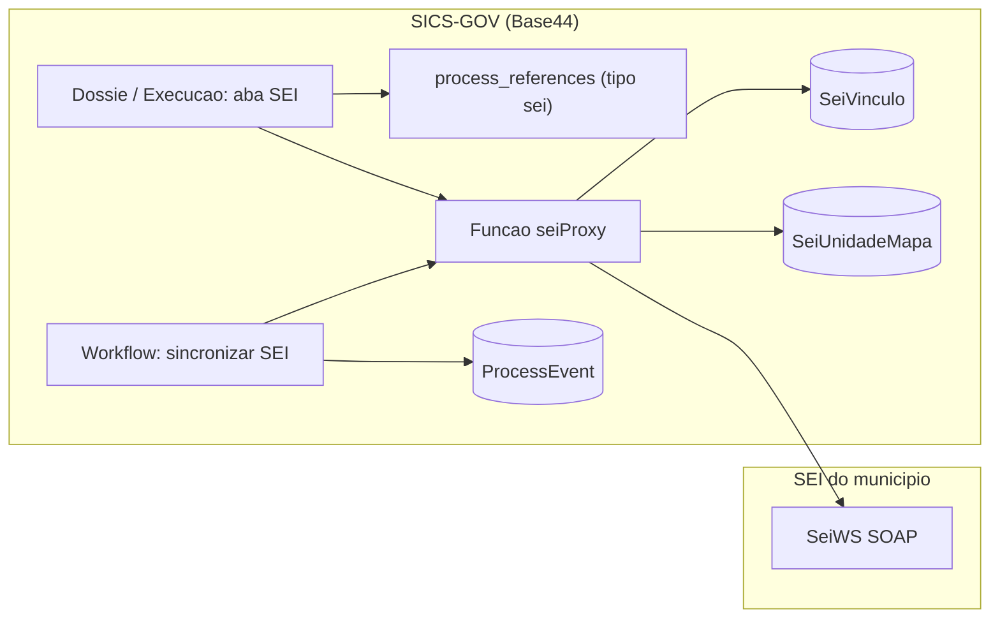

# 08. Plano e projeto: agregar o SEI ao SICS-GOV

Este arquivo substitui as suposições sobre o SICS feitas nos arquivos 02 a 06. Ele parte da leitura do aplicativo **SICS-GOV** no Base44 (somente leitura; nada foi alterado no aplicativo) e do mapa do SEI no arquivo 01.

**O que foi lido no SICS-GOV:** a listagem de diretórios (truncada em 1.000 entradas, então a contagem abaixo é um piso), os esquemas `ProcessEvent`, `Unidade`, `Superintendencia`, `ProtocoloDocumento` e `InstituicaoConfig`, o módulo `base44/shared/processReferences.ts`, o início das funções `pncpProxy` e `registrarAndamentoDossier`, a lista de workflows e buscas por "1Doc" e por segredos. O restante do código não foi lido.

**O que continua sem verificação:** se o município tem SEI instalado, em qual versão, e se ele é alcançável pela internet. Sem isso, as fases 2 em diante não saem do papel.

## 1. O que o SICS-GOV é hoje

- Aplicativo Base44 da SEMUS para contratações públicas: licitações (`Dossier`), execução (`ExecutionProcess`), PCA, DFD, ETP, cotações e cestas de preços, atas e SRP, credenciamento (COPEC), empenhos e QDD, notas fiscais, protocolos de documentos, diárias, almoxarifado, hospedagem, transparência e controle interno.
- Tamanho observado: pelo menos 213 entidades, 98 funções de backend (Deno/TypeScript), 104 workflows agendados ou de backup e 109 módulos compartilhados.
- Existe também o aplicativo **SICS-SAÚDE (Copy)** na mesma conta, que pode servir de ambiente de teste (a confirmar com o usuário se é esse o papel dele).

## 2. Como o SICS-GOV trata o 1Doc hoje

O 1Doc não está integrado por API. Ele aparece como **referência externa digitada à mão**:

| Onde | Como |
|---|---|
| `Dossier` | Lista `process_references` com tipos `1doc`, `prodata_mae`, `prodata_compra`, `outro`, `link`, `pasta`, `escaneado`, `planejamento_demanda`. Campos legados `onedoc_number` e `onedoc_url` são espelhos do primeiro item `1doc`. |
| `processReferences.ts` | Normaliza números, impede duplicatas e mantém os espelhos legados. É o ponto central de qualquer novo tipo de referência. |
| Busca e assistente | `processSearch.ts`, `sicsAssistant.ts` e `planejamentoAcervo.ts` procuram processos por `onedoc_number`. |
| Credenciamento (COPEC) | Convocação, aceite e ratificação exigem protocolo e link do 1Doc (`copecStageFour.ts`, `copecQueueGates.ts`); o canal da resposta é gravado como `'1doc'`. |
| Outras entidades | `Lembrete.onedoc_url`, `WarehouseReceipt.onedoc_reference`, `AtaRequisicao.protocolo_1doc`, links em `DiariaSolicitacao`, canal `1doc` em `Credenciado`. |
| Documentos SEPLAN | O número oficial "vem de fora (1Doc)", segundo `docs/plano-seplan-documentos.md`. |
| Transparência | Publica o link do 1Doc quando existe (`transparencia.ts`). |

Conclusão: o SICS já é o sistema de trabalho, e o 1Doc é o lugar onde o ato oficial é protocolado, tramitado e assinado. Agregar o SEI significa pôr o SEI nesse mesmo papel, primeiro como referência e depois com leitura e escrita automáticas, coisa que o 1Doc nunca teve no SICS.

## 3. O que isso resolve do plano anterior

- **O risco central desaparece.** O SeiWS não lista nem pesquisa processos, mas o SICS já guarda o número de cada processo no dossiê. A lista de processos a acompanhar vem do próprio SICS (decisão D1, opção 1).
- **Não é preciso um serviço intermediário separado.** O SICS-GOV já tem o padrão: funções de backend que falam com sistemas externos (`pncpProxy`, `infosimplesProxy`, `bancoPrecosProxy`, `assinaturaGovBr`), segredos em variáveis de ambiente e workflows agendados. O adaptador SEI entra como mais uma função.
- **A linha do tempo já existe.** `ProcessEvent` é gravado no servidor, tem `event_key` (serve de chave de idempotência) e vínculo com dossiê e execução.
- **Unidades já existem.** `Superintendencia` e `Unidade` têm sigla e lista de e-mails com acesso; há ainda `PCAOrganograma`. O de-para com as unidades do SEI parte daí e do organograma do arquivo 07.

## 4. Arquitetura proposta

Componentes novos, todos dentro do SICS-GOV:

| Componente | Tipo | Papel |
|---|---|---|
| Tipo `sei` em `REFERENCE_KINDS` | alteração em módulo compartilhado | Guardar o número do processo SEI (NUP) e o link, como já se faz com o 1Doc. |
| `seiProxy` | função de backend | Único ponto que fala com o SEI. Monta o envelope SOAP, autentica com `SiglaSistema` e `IdentificacaoServico`, converte ISO-8859-1, aceita só uma lista fechada de operações e exige usuário autenticado, no mesmo molde do `pncpProxy`. |
| Segredos | configuração | `SEI_WS_URL`, `SEI_SIGLA_SISTEMA`, `SEI_IDENTIFICACAO_SERVICO`, `SEI_ID_UNIDADE_PADRAO`. A chave nunca vai ao navegador nem a registros. |
| `SeiVinculo` | entidade | Um registro por processo acompanhado: dossiê ou execução, NUP, `IdProcedimento`, último andamento visto, hash, data da última consulta, nível de acesso, estado (ativo, erro, pausado). |
| `SeiUnidadeMapa` | entidade | De-para entre `Superintendencia`/`Unidade` do SICS e `IdUnidade` do SEI. |
| Aba "SEI" no dossiê e na execução | tela | Situação no SEI, unidades onde o processo está aberto, andamentos, lista de documentos com link. |
| "Sincronizar SEI" | workflow agendado | Percorre os `SeiVinculo` ativos, consulta o SEI e grava as novidades em `ProcessEvent`. |

## 5. Como vai funcionar, por fase

### Fase 1. SEI como referência (não depende de credencial)

1. Acrescentar o tipo `sei` às referências de processo, com validação do formato do NUP.
2. Incluir o número SEI na busca de processos e no assistente.
3. Mostrar o número e o link do SEI no resumo do dossiê e na execução, ao lado do 1Doc.

Resultado: o usuário já registra o processo SEI no SICS, e as fases seguintes têm de onde partir. Nada do 1Doc é removido.

### Fase 2. Leitura sob demanda

1. O administrador do SEI cadastra o Sistema "SICS" e um Serviço com Chave de Acesso, só com operações de consulta (checklist no arquivo 01, seção 6).
2. Entra a função `seiProxy` com `consultarProcedimento`, `consultarDocumento`, `listarAndamentos`, `listarUnidades`, `listarSeries`, `listarTiposProcedimento` e `listarHipotesesLegais`.
3. Ao abrir a aba "SEI" de um dossiê com referência `sei`, o SICS consulta o SEI e mostra situação, unidades, andamentos e documentos.
4. O primeiro acesso cria o `SeiVinculo`.

Regra de sigilo: o `seiProxy` devolve conteúdo só de processos públicos; de restritos devolve metadados mínimos; sigilosos, ausentes ou desconhecidos são bloqueados (arquivo 04). O SICS continua aplicando suas próprias permissões de dossiê antes de chamar o SEI.

### Fase 3. Acompanhamento automático

1. O workflow "Sincronizar SEI" roda em intervalos (sugestão inicial: a cada hora em horário comercial; a calibrar com o administrador do SEI).
2. Para cada `SeiVinculo` ativo, consulta o último andamento. Se mudou, busca os andamentos novos e grava um `ProcessEvent` para cada um, com `event_key` no formato `sei:<IdProcedimento>:<IdAndamento>`, o que impede duplicatas.
3. Andamentos relevantes (processo recebido na unidade, documento assinado, processo concluído) geram alerta pelos mecanismos que o SICS já tem (`Alert`, e-mail, push).
4. Falhas ficam registradas no `SeiVinculo` e aparecem na central de erros; depois de N falhas seguidas o vínculo é pausado e sinalizado.

### Fase 4. Escrita no SEI (cada ação confirmada por uma pessoa)

Requer permissões de escrita no Serviço do SEI e aprovação própria.

1. **Abrir processo:** a partir de um dossiê sem número SEI, o SICS chama `gerarProcedimento` e grava o NUP devolvido como referência `sei`.
2. **Incluir documento:** os documentos que o SICS já gera (DFD, ETP, atas, ofícios, laudos, relatórios) são enviados com `incluirDocumento` como documento externo em PDF; arquivos grandes usam `adicionarArquivo`.
3. **Tramitar:** `enviarProcesso` para a unidade de destino, usando o `SeiUnidadeMapa`.
4. **Registrar andamento:** `lancarAndamento` para marcos do SICS que precisam constar no SEI.

Cuidados: o SEI não desfaz inclusões, então cada envio grava antes uma intenção com chave única e só então chama o SEI; repetir o clique não duplica. A assinatura continua sendo feita no SEI, porque o SeiWS 4.0 não tem operação de assinar.

### Fase 5. Substituição gradual do 1Doc

1. Onde o SICS hoje exige "protocolo no 1Doc" (credenciamento, requisições de ata, documentos SEPLAN), a regra passa a aceitar "protocolo no sistema oficial", com 1Doc ou SEI.
2. Processos novos nascem no SEI; os antigos mantêm a referência ao 1Doc para consulta.
3. O organograma do arquivo 07 vira a base do cadastro de unidades no SEI e do `SeiUnidadeMapa`, depois de resolvidas as siglas repetidas e as unidades sem usuário.
4. O 1Doc só é desligado quando houver decisão sobre o histórico (migrar ou manter para consulta) e um período de convivência sem pendências.

## 6. Mapeamento de dados

| SEI | SICS-GOV | Observação |
|---|---|---|
| `ProcedimentoFormatado` (NUP) | `Dossier.process_references[kind=sei].number` | Chave de negócio; normalizada por `normalizeReferenceNumber`. |
| `IdProcedimento` | `SeiVinculo.id_procedimento` | Chave técnica; não aparece para o usuário. |
| `LinkAcesso` | `process_references[kind=sei].url` | Abre o processo no SEI. |
| `UnidadesProcedimentoAberto` | `SeiVinculo.unidades_abertas` | Exibido na aba SEI; lista vazia indica processo concluído. |
| Andamento (`IdAndamento`, `DataHora`, `Descricao`, `Unidade`) | `ProcessEvent` (`event_key`, `timestamp`, `title`, `action`) | `source_entity = 'SeiVinculo'`. |
| Documento (`IdDocumento`, `DocumentoFormatado`, `Serie`, `Data`) | Lista na aba SEI; opcionalmente `Dossier.doc_links` | Só metadados e link na primeira entrega. |
| `NivelAcessoGlobal`, `IdHipoteseLegal` | `SeiVinculo.nivel_acesso`, `hipotese_legal` | Decide o que pode ser exibido. |
| Unidade (`IdUnidade`, `Sigla`) | `SeiUnidadeMapa` ligado a `Superintendencia` ou `Unidade` | Preenchido uma vez a partir de `listarUnidades`. |

Os nomes dos campos do `Dossier` além dos citados precisam ser conferidos no esquema completo antes da implementação; li apenas os trechos de referência.

## 7. Restrições técnicas a resolver antes da Fase 2

1. **Alcance de rede.** As funções do Base44 rodam na nuvem. O endereço do Web Service do SEI precisa ser acessível pela internet com HTTPS. Se o SEI só responde na rede interna da prefeitura, será preciso um ponto de entrada publicado pela TI (proxy reverso ou gateway) restrito a essa integração.
2. **Endereço de saída.** Não verifiquei se o Base44 oferece IP de saída fixo. Sem isso, a liberação por IP no firewall do órgão não é possível e a proteção fica na Chave de Acesso e no ponto de entrada. A confirmar com o Base44 e com a TI.
3. **SOAP em Deno.** O envelope é montado e lido como XML dentro da função. A codificação do exemplo oficial é ISO-8859-1; a conversão para UTF-8 fica no `seiProxy`.
4. **Tempo de execução.** O workflow de sincronização deve processar em lotes pequenos por execução, com continuação na próxima, para não estourar o limite de tempo das funções (limite a confirmar).
5. **Permissões.** `ProcessEvent` só aceita escrita de administrador pelas regras atuais; a sincronização grava como serviço, como já fazem outras funções do SICS.
6. **Versão do SEI.** O arquivo 01 foi conferido contra o manual 4.0. Se a instalação for 5.x, as operações usadas precisam ser reconferidas no WSDL real.

## 8. Entregas e estimativa

Estimativas grosseiras, para uma pessoa com apoio do construtor do Base44; dependem principalmente do prazo da TI para liberar o acesso ao SEI.

| Fase | Entrega | Depende de | Estimativa |
|---|---|---|---|
| 1 | Tipo de referência `sei`, busca e exibição | nada externo | 2 a 4 dias |
| 2 | `seiProxy` de leitura, `SeiVinculo`, aba SEI | credencial de homologação e acesso de rede | 2 a 3 semanas |
| 3 | Workflow de sincronização, eventos e alertas | Fase 2 estável | 1 a 2 semanas |
| 4 | Abrir processo, incluir documento, tramitar | permissão de escrita, `SeiUnidadeMapa`, aprovação | 3 a 5 semanas |
| 5 | Regras "sistema oficial", convivência e desligamento do 1Doc | decisão institucional e unidades cadastradas no SEI | a definir |

Cada fase é testada primeiro no aplicativo de cópia e contra o SEI de homologação, com os casos do arquivo 05 que se aplicam (idempotência, sigilo, SEI fora do ar, resposta malformada).

## 9. Papéis dos agentes neste projeto

| Agente | O que faz daqui em diante |
|---|---|
| Governador | Mantém este plano, decide a ordem das fases e os pontos de aprovação. |
| Especialista em SEI | Confere o WSDL da instalação real, prepara o pedido de cadastro do Sistema e do Serviço, valida cada operação usada. |
| Arquiteto de Integração | Desenha o `seiProxy`, o `SeiVinculo` e o workflow; resolve o alcance de rede com a TI. |
| Dados e Mapeamento | Tipo `sei` nas referências, `SeiUnidadeMapa`, de-para do organograma do arquivo 07. |
| Segurança e Conformidade | Regra de sigilo no `seiProxy`, guarda da chave, trilha de auditoria, parecer com o encarregado. |
| Qualidade e Testes | Casos de teste por fase, simulador do SeiWS para rodar sem o SEI, regressão dos módulos que hoje citam o 1Doc. |
| Gestão e Implantação | Piloto por superintendência, convivência 1Doc e SEI, comunicação e treinamento. |

## 10. Perguntas que ainda travam o projeto

1. A prefeitura já tem o SEI instalado? Em qual versão, e existe ambiente de homologação?
2. O SEI é acessível pela internet ou só pela rede interna?
3. Quem é o administrador do SEI que pode cadastrar o Sistema "SICS" e gerar a Chave de Acesso?
4. O aplicativo "SICS-SAÚDE (Copy)" pode ser usado como ambiente de teste?
5. A primeira entrega deve ser só leitura (fases 1 a 3) ou a abertura de processos e o envio de documentos ao SEI (fase 4) já são prioridade?
6. O histórico do 1Doc precisa ser migrado ou basta mantê-lo para consulta?
